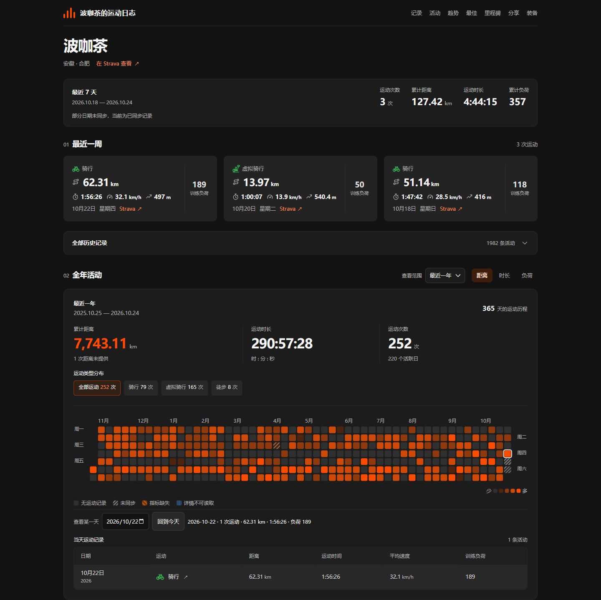
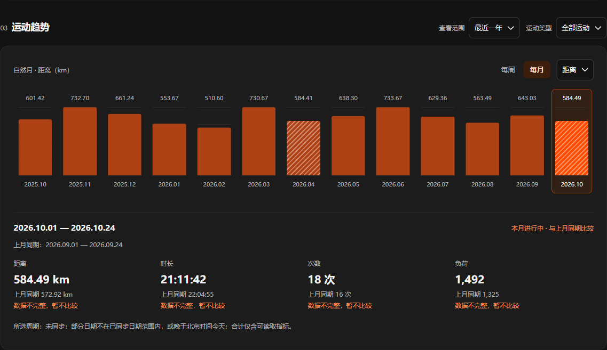
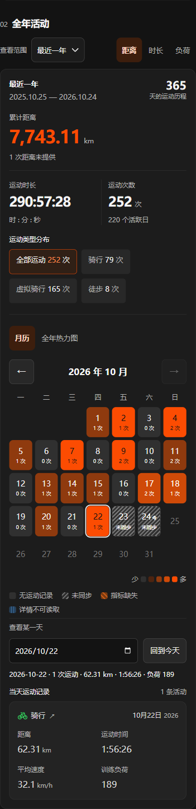
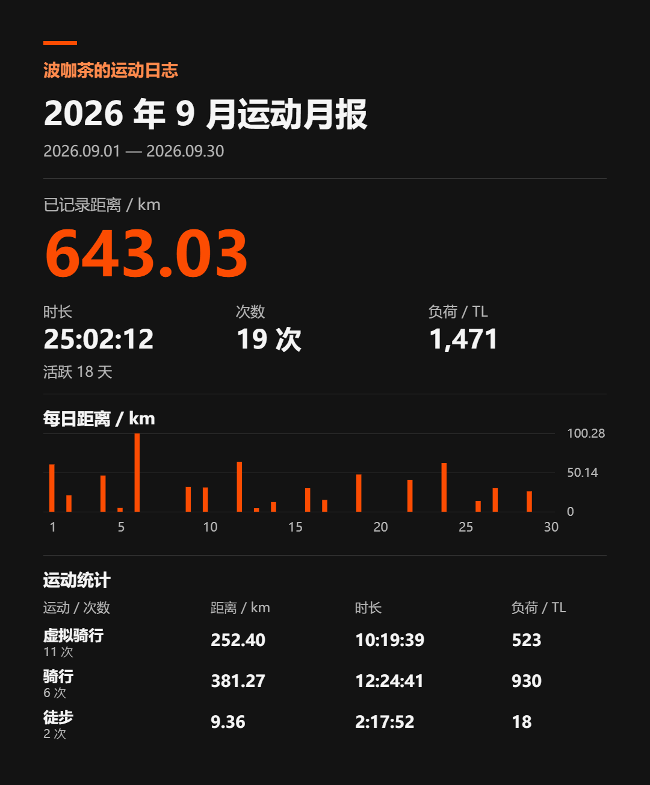
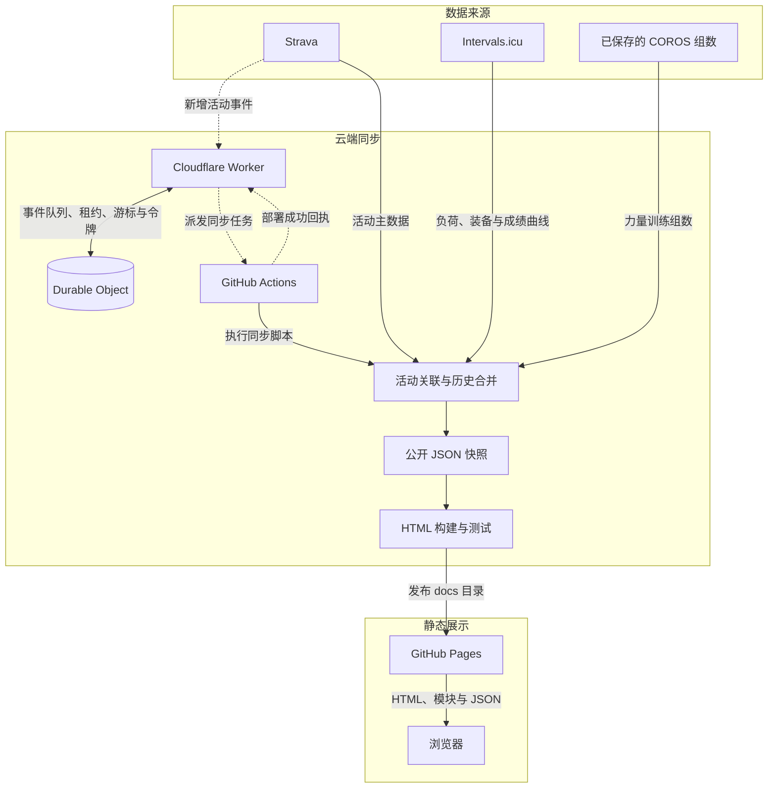
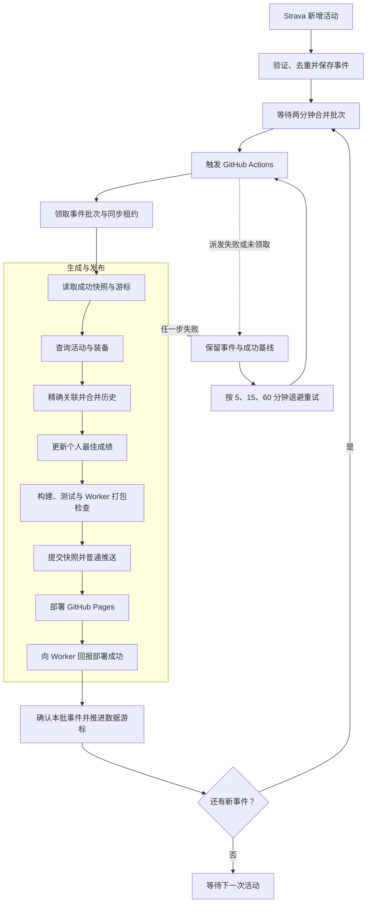
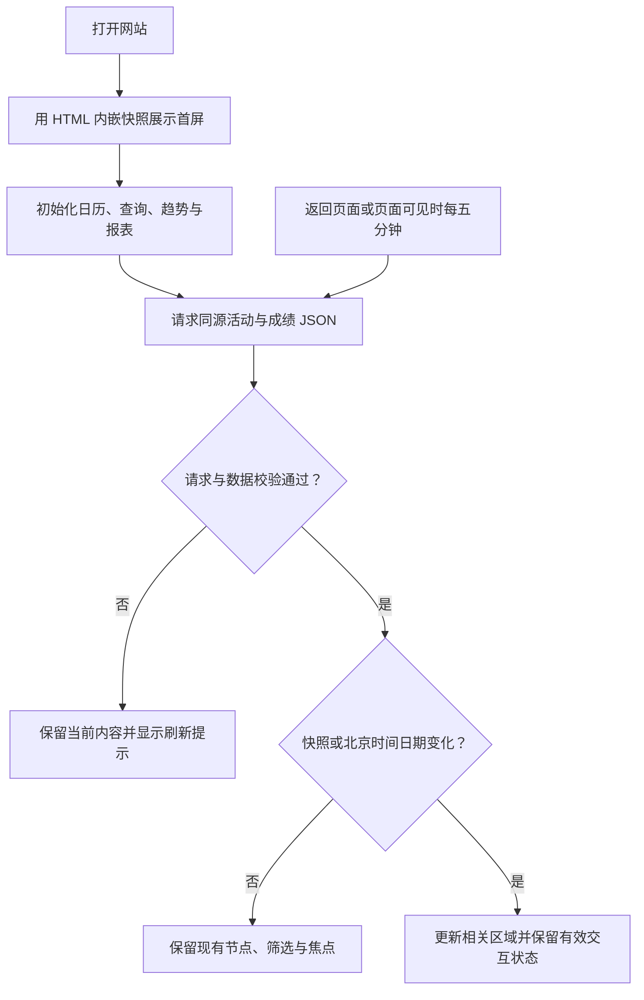

# 波咖茶的运动日志

把每一次出发，汇成看得见的运动轨迹。

一个面向个人的中文运动日志：以 Strava 为活动主数据源，整合 Intervals.icu 的训练负荷、装备与个人最佳成绩，以及已保存的 COROS 力量训练组数。网站采用原生 JavaScript 和静态快照，发布到 GitHub Pages；数据同步在云端完成，本机关机也能更新。

**[访问网站 ↗](https://pircate.github.io/activity-journal/)**

[功能与预览](#功能与预览) / [整体架构](#整体架构) / [同步与发布流程](#同步与发布流程) / [前端设计](#前端设计) / [数据约定](#数据约定) / [本地开发](#本地开发) / [部署与维护](#部署与维护)

## 功能与预览

| 功能 | 可以做什么 |
| --- | --- |
| 记录与查询 | 查看最近七天摘要，按日期、运动类型和距离筛选全部历史 |
| 活动日历 | 用全年热力图或手机月历回看每天的运动，切换距离、时长与负荷 |
| 周月趋势 | 按周、月汇总运动量，将本周、本月与上一周期的同期数据比较 |
| 成绩与积累 | 查看跑步最佳用时、骑行距离与功率纪录，追踪里程、次数和活跃日等累计目标 |
| 回顾与分享 | 生成月报、年报，预览并下载 PNG 图片，全部在浏览器本地完成 |
| 装备维护 | 查看自行车与配件里程，汇总临近或已达建议更换里程的配件 |

### 桌面概览

最近一周的活动与年度统计集中展示，点选热力图日期即可查看当天记录。



<details>
<summary><strong>运动趋势</strong>：周月汇总与同期对比</summary>

距离、时长、次数和训练负荷可独立切换，选择柱条查看对应周期的明细与比较结果。



</details>

<details>
<summary><strong>手机月历</strong>：选一天，查看当天运动</summary>

七列月历适配手机屏幕，支持翻月和回到今天，下方以纵向卡片展示当天活动。

<p align="center">
  
</p>

</details>

<details>
<summary><strong>分享图片</strong>：把一个月或一年的运动保存下来</summary>

图片包含周期总览、运动量图表和各运动类型明细，可下载或在手机上长按保存。

<p align="center">
  
</p>

</details>

*截图仅作功能示意，最新记录以网站为准。*

## 整体架构

系统分为数据来源、云端同步和静态展示三部分。Worker 负责事件与同步状态，Actions 负责取数、校验和发布，浏览器负责展示与交互。



### 职责划分

| 层次 | 主要实现 | 职责 |
| --- | --- | --- |
| 事件协调 | `workers/strava-webhook/index.mjs` | 验证并去重事件、合并批次、管理租约与重试，持久保存轮换后的 Strava 刷新令牌 |
| 流程编排 | `.github/workflows/site.yml`、`scripts/site-sync.mjs` | 领取批次，选择成功基线，依次执行同步、构建、测试、提交、部署与回执 |
| 取数与合并 | `scripts/fetch-site-data.mjs`、`scripts/activity-sync.mjs` | 查询平台数据，按真实平台标识关联，保留未返回的历史与已知指标 |
| 成绩同步 | `scripts/update-personal-bests.mjs` | 获取全历史配速、功率曲线，并从活动快照计算最远骑行 |
| 静态构建 | `scripts/build.mjs` | 读取资料和快照，生成内嵌首屏数据的 `docs/index.html` |
| 展示与交互 | `docs/app.js`、`docs/*.mjs`、`docs/style.css` | 日历、筛选、趋势、报表与装备展示，以及同源快照刷新 |
| 结果通知 | `scripts/notify-site.py` | 独立发送发布成功或失败邮件，并提供运行日志链接 |

### 为什么这样设计

- **用静态快照承接平台数据。** 页面访问不依赖平台 API 的即时可用性，浏览器只读取 Pages 上的公开文件；平台凭据留在云端。
- **用事件驱动更新。** Strava 新活动触发同步，Worker 在首次事件后等待两分钟合并批次，减少重复任务。
- **以成功部署作为同步完成边界。** Git 提交只是中间产物，只有 Pages 部署成功并完成回执，才推进数据游标。
- **在构建与浏览器中复用计算逻辑。** 日期、指标汇总、缺失状态与格式化集中在共享模块，减少首屏和交互后的口径差异。

## 同步与发布流程

### 一次活动更新如何上线



重试耗尽后仍保留事件，等待新事件或手动运行恢复。Actions 串行执行且不取消正在运行的任务；单次运行限时 25 分钟，同步租约为 30 分钟，任务失联后由租约到期触发恢复。运行期间到达的新事件留给下一批，不会被本批回执误确认。

### 增量、全量与代码发布

| 入口 | 数据处理 | 成功后状态变化 |
| --- | --- | --- |
| Strava 新增活动事件 | 默认增量同步；旧日期事件直接查详情并扩大窗口 | 确认已领取事件，更新同步游标与成功数据版本 |
| 手动运行工作流 | 默认增量；`full=true` 强制全量 | 与事件同步相同，也可用于故障恢复 |
| `main` 上匹配路径的代码 push | 使用成功数据快照构建发布 | 记录发布成功，不推进数据游标与成功数据版本 |

首次同步、数据规则版本变化或没有有效游标时执行全量。后续增量从上次成功**同步开始时间**对应的北京时间日期向前重叠两天查询；装备与个人最佳成绩每次完整查询。超出增量窗口的历史修改需要手动全量核对。

合并按平台 ID 和已有真实链接关联，冲突即停止，不按日期或名称猜测。Strava 未返回的历史记录与已知负荷、组数予以保留，并生成历史修正报告。全量同步同样不会自动删除历史。

提交的数据文件为 `docs/activities.json`、`docs/personal-bests.json` 和 `docs/index.html`。推送冲突时停止，不强推；失败同步即使已经将快照提交到 `main`，后续普通代码发布仍从成功版本取数据，避免将失败残留发布上线。

### 结果通知

独立的通知任务发送成功、失败或取消结果邮件，包含网站、发布版本和 Actions 日志链接；重复事件跳过时不发信。邮件失败单独报错，不回滚部署，也不触发数据同步重试。

## 前端设计

### 静态首屏与渐进刷新

构建脚本将个人资料、活动和成绩快照写入 HTML，页面打开后即可展示首屏。原生 ES modules 接管交互，再检查同源 JSON 的更新。



请求使用 `no-cache` 进行缓存再验证；活动快照比当前版本更旧时不覆盖页面。脚本与样式使用内容哈希版本号，依赖模块沿用同一版本，避免代码更新后继续加载旧缓存。活动数据和成绩分别刷新，失败时各自保留已显示内容。

### 模块与状态边界

| 模块 | 主要职责 |
| --- | --- |
| `activity-data.mjs` | 运动类型、指标适用性与活动汇总 |
| `journal.mjs` | 北京时间、数据校验、格式化、日历数据与通用展示 |
| `app.js`、`calendar.mjs` | 页面协调、年度范围、运动类型筛选、日期选择与月历交互 |
| `history.mjs`、`trends.mjs` | 全历史查询、分页、周月聚合与同期对比 |
| `personal-bests.mjs`、`milestones.mjs` | 最佳成绩与全历史累计目标 |
| `reports.mjs` | 独立周期选择、月报年报预览与 PNG 导出 |

全年活动默认查看最近 365 天，也可选择自然年。其年份与运动类型筛选只作用于年度概览和每日视图；近期记录、历史查询、趋势、成绩、里程碑、分享报表和装备各自保持独立状态。趋势有自己的范围与类型筛选；成绩、里程碑和装备覆盖全部历史。

桌面以热力图和表格展示，宽度不超过 600px 时默认使用月历与纵向活动卡片。日期选择支持键盘操作，“回到今天”按北京时间定位。刷新保留有效的筛选、日期、分页和装备展开状态；数据与日期没有变化时不重建活动视图，装备内容没有变化时不重建装备节点。

### 视觉约定

界面采用深色背景、橙色强调与 Radix UI Colors，以数据和操作为主，减少解释文案和动画。边框宽度为 `0.5px`，字号最多四种且不小于 `12px`；运动图标搭配中文名称，缺失状态同时提供纹理与文字提示。

## 数据约定

### 来源与公开边界

| 来源 | 提供内容 | 处理原则 |
| --- | --- | --- |
| Strava | 日期、开始时间、运动类型、距离、运动时间、爬升、平均心率与卡路里 | 活动主数据源，保留真实活动链接 |
| Intervals.icu | 训练负荷、装备、全历史配速与功率曲线 | 按真实关联补充指标，不要求新活动已被收录才发布 |
| `data/strength-sets.json` | 已核对的 COROS 力量训练组数 | 通过明确活动关联补充，不按日期或名称匹配 |
| `data/profile.json` | 姓名、地区与 Strava 主页 | 构建时生成个人资料、页面标题与分享标题 |

日期和同日开始时间使用北京时间，同日按开始时间排序。快照保存运动代码、数值秒和来源精度的公里数；中文名称、单位与舍入在展示层生成。距离显示两位小数，用时使用可超过 24 小时的 `时:分:秒`，配速按运动类型显示每公里或每百米用时。

公开文件只保留展示所需字段，不发布平台原始响应、坐标、心率明细、凭据或内部装备备注。完整字段与合并规则见 [网站同步说明](docs/SITE-SYNC.md)。

### 缺失与零值

| 情况 | 含义 | 展示与统计 |
| --- | --- | --- |
| 有效零值 | 指标明确为 `0` | 正常显示，参与统计 |
| 已同步但无活动 | 日期已覆盖，且没有活动记录 | 显示无运动，不当作同步失败 |
| 未同步 | 日期未被同步范围覆盖，或属于未来日期 | 灰色斜纹，不推断为零活动 |
| 指标缺失 | 活动可读取，但某个适用指标未提供 | 显示“未提供”或 `—`，不将未知值替换为 0 |
| 详情不可读取 | 只有日期等有限信息，无法取得完整活动详情 | 蓝色交叉纹理，不计入距离、时长与次数 |

日历、近期摘要、趋势与报表共用指标口径。当天部分指标缺失时叠加纹理，混有不可读取记录时另加边框；趋势比较中，未同步或不可读取的周期不计算增减百分比，单项缺失只暂停该项比较。

力量训练的距离不适用，不累计距离，也不计为距离缺失。展示优先级为组数、卡路里，平均心率作为副指标；`0` 组仍优先显示。训练负荷直接采用 Intervals.icu 统计值。

### 装备维护规则

装备在 Intervals.icu 中维护，网站只读展示在用自行车与配件。链条、外胎的建议更换里程为 5000 km，飞轮为 10000 km，牙盘为 30000 km；达到 80% 时提示接近建议里程。共享配件按平台关系展示，维护摘要只计一次。

每个受支持配件应设置唯一一个名为“更换”的提醒；更换后里程取 `distance_used`，日期取提醒重置时间。前后外胎名称以“前胎”“后胎”开头。缺少提醒、提醒重名、日期或里程未提供时明确显示缺失，不用购买日期或累计里程猜测。历史换件通过配件备注中的明确记录补充，并校验提醒标识、重置时间与起始计数；备注中的内部信息不公开。具体解析与校验见 [`scripts/update-data.mjs`](scripts/update-data.mjs)。

## 目录结构

```text
.
├── docs/                         # Pages 发布目录
│   ├── index.html                # 构建产物，不手工编辑
│   ├── activities.json           # 活动与装备公开快照
│   ├── personal-bests.json        # 个人最佳成绩公开快照
│   ├── app.js                    # 浏览器入口
│   ├── *.mjs                     # 计算与展示模块
│   ├── style.css                 # 页面样式
│   ├── images/                   # README 截图
│   ├── SITE-SYNC.md              # 数据与合并规则
│   └── WEBHOOK.md                # 部署、Secrets 与恢复操作
├── scripts/                      # 同步、构建、通知与测试
├── data/                         # 个人资料、力量组数与同步辅助数据
├── workers/strava-webhook/        # Worker 与 Durable Object
├── .github/workflows/site.yml    # 云端同步与发布入口
└── output/                       # 临时产物，不提交
```

## 本地开发

需要 Node.js 22 或更新版本、Python 3。已有快照可直接用于构建和预览，无需配置平台凭据。

```sh
npm ci
node scripts/build.mjs
python3 -m http.server 8787 --bind 127.0.0.1 --directory docs
```

访问 <http://127.0.0.1:8787/>。修改页面结构时编辑 `scripts/build.mjs`，修改计算或交互时编辑 `docs/` 下对应模块，然后重新构建；不要直接修改生成的 `docs/index.html`。

### 验证

```sh
npm test
python3 -m unittest discover -s scripts -p 'test_*.py'
node scripts/build.mjs
npm run worker:check
```

JavaScript 使用 `node:test`，Python 使用 `unittest`，外部平台与邮件在测试中模拟。界面改动还需检查桌面、手机、键盘操作和溢出，并保留截图。

Worker 本地调试使用 `npm run worker:dev`，测试配置放在已忽略的 `workers/strava-webhook/.dev.vars`。

### 本地取数调试

通过环境变量提供 `STRAVA_ACCESS_TOKEN` 与 `INTERVALS_ICU_API_KEY`；Intervals.icu 也支持读取仓库外的 `~/.config/interval-icu/config.json`。不要将实际凭据写入仓库或命令历史。

```sh
node scripts/fetch-site-data.mjs --full
node scripts/update-personal-bests.mjs
node scripts/build.mjs
```

这些命令会改写本地快照与 HTML，不推进云端成功游标。活动取数脚本还支持 `--baseline`、`--since`、`--events` 与 `--report`。`scripts/sync.mjs` 用于显式维护 COROS 组数，要求真实且新鲜的 COROS 输入，不属于自动发布链路。

## 部署与维护

首次部署依次配置 Cloudflare Worker、Strava webhook 订阅、GitHub Secrets 和 Pages 的 GitHub Actions 发布源，再手动全量同步。完整步骤见 [Webhook 部署与恢复](docs/WEBHOOK.md)。

日常恢复使用 GitHub CLI：

```sh
# 手动增量同步，也会处理尚未确认的事件
gh workflow run site.yml --repo Pircate/activity-journal --ref main

# 全量核对历史，补齐超出增量窗口的指标修改或漏通知
gh workflow run site.yml --repo Pircate/activity-journal --ref main -f full=true

# 查看最近运行结果
gh run list --repo Pircate/activity-journal --workflow site.yml --limit 5
```

排查时先看 Actions 失败步骤、历史修正报告和 Worker 的 `/sync/status`：`lastSuccessfulAt` 是最近成功部署时间，`cursor` 是成功数据同步开始时间，`publishedCommit` 是成功数据版本，`pending` 表示未确认事件。云端以 Durable Object 的状态为准，`data/sync-state.json` 只服务本地维护流程。

当前 webhook 处理新增活动，旧活动的编辑和删除不会主动触发更新；历史未返回记录按保守合并规则保留。涉及数据规则切换和成功基线摘要校验时，先阅读 [网站同步说明](docs/SITE-SYNC.md#发布和恢复)，避免直接使用失败同步留在 `main` 上的快照。
